# Taqyem Web

Learner and administrator web client for **Taqyem** — cohort assessments, guided quiz launch, integrity-aware attempts, AI-assisted authoring, and submission review.

Built with **React 19**, **Vite**, **Redux Toolkit Query**, **React Router**, and **Tailwind CSS 4**. Talks exclusively to the Taqyem NestJS API over JWT.

---

## Product surface

| Role | Experience |
| :--- | :--- |
| **Administrator** | Quiz catalog, launch wizard, question bank, AI draft modal, invitations, analytics, attempt review (incl. essay override), follow-up, live submission alerts |
| **Learner** | Dashboard, invitation deep links, timed attempt (autosave), results when policy unlocks, platform chat (hidden during graded attempts) |

---

## Screenshots

Assets live under [`docs/screenshots/`](docs/screenshots/).

### Marketing

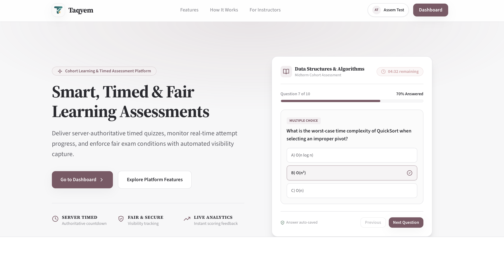

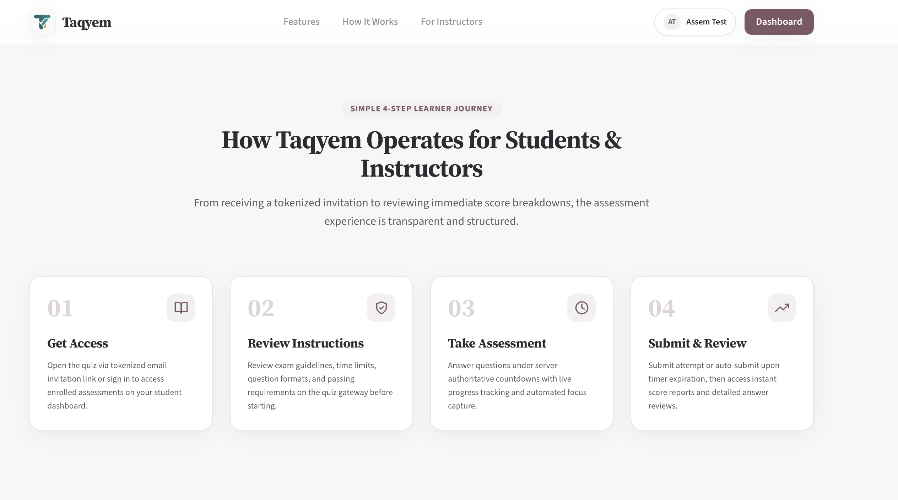

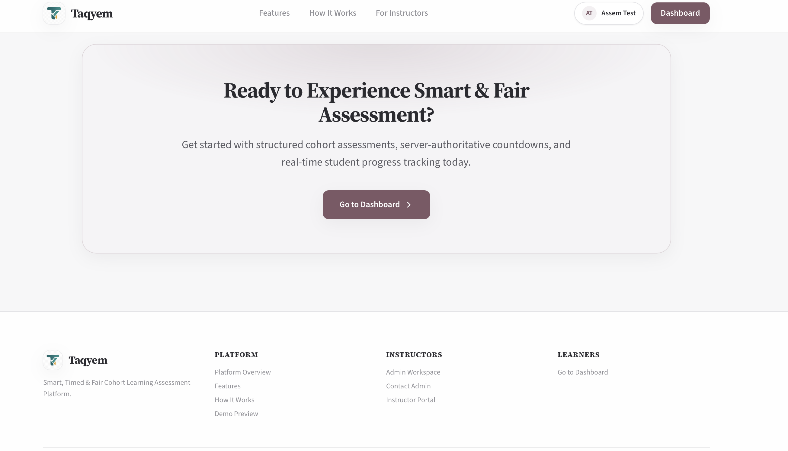

### Authentication

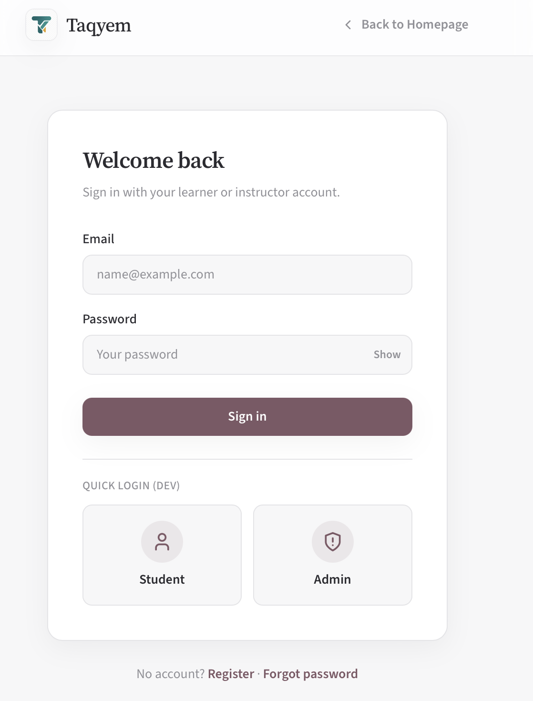

### Administrator

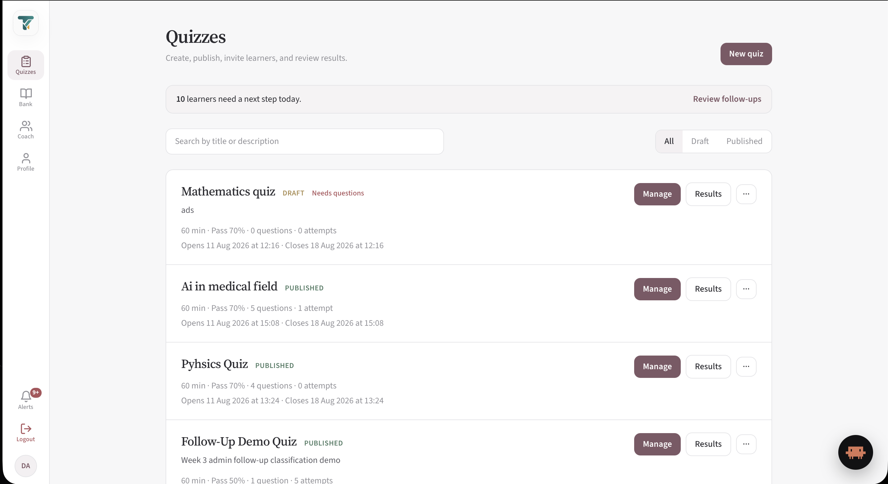

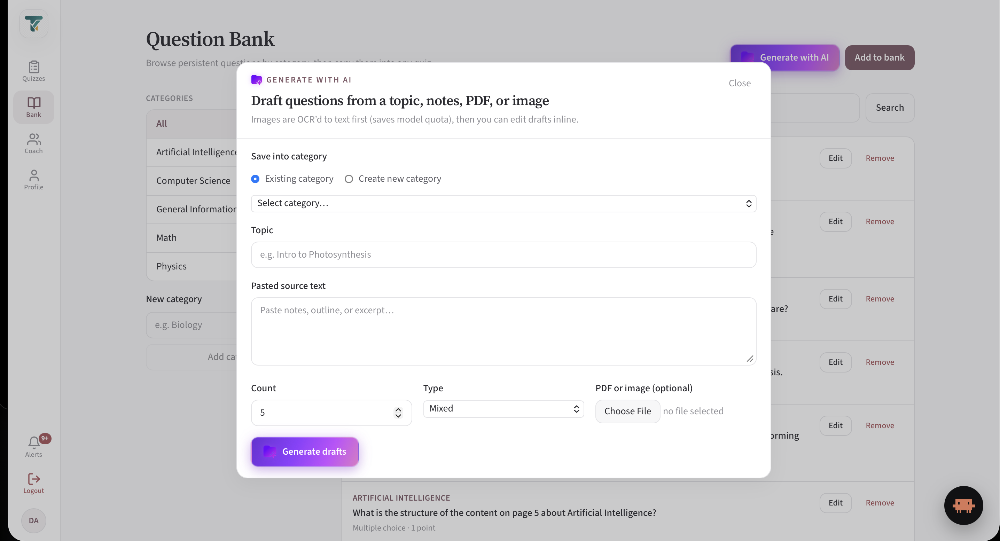

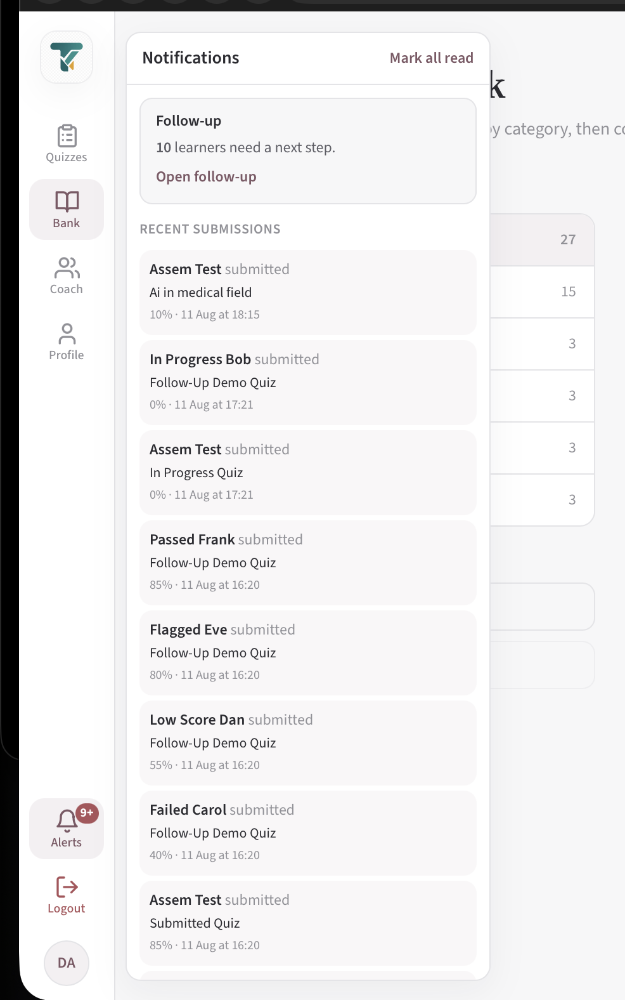

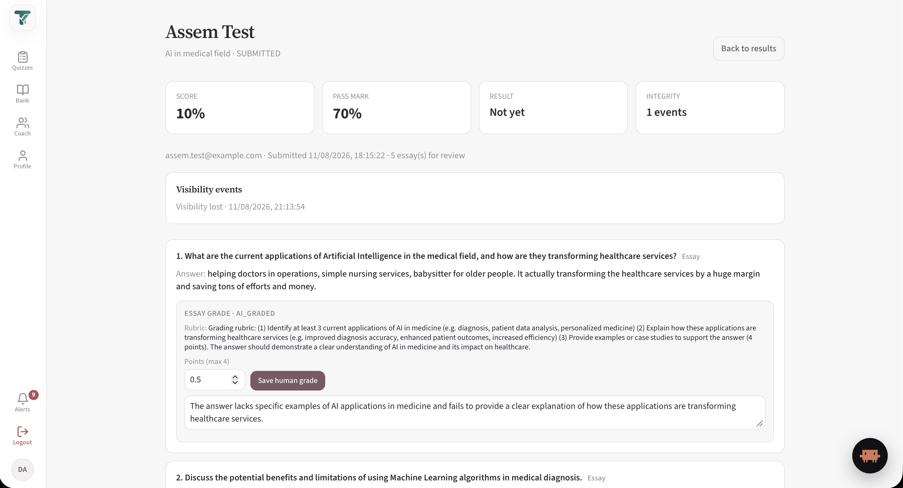

### Learner

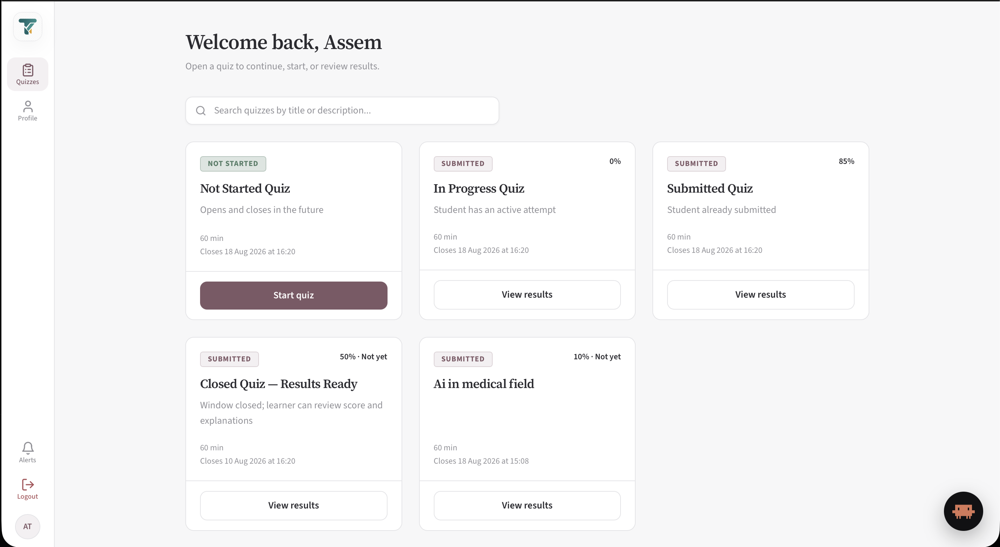

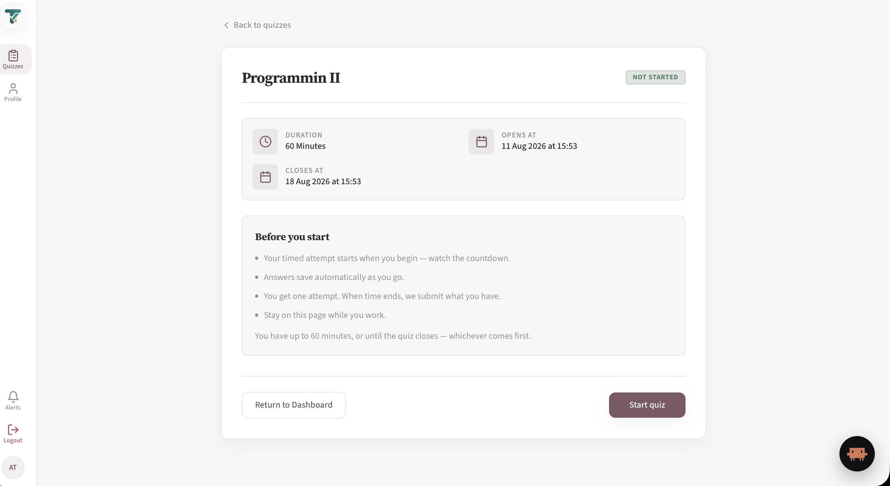

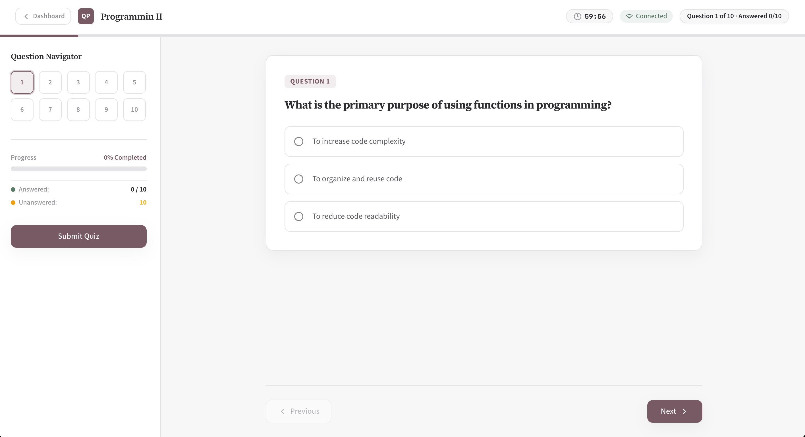

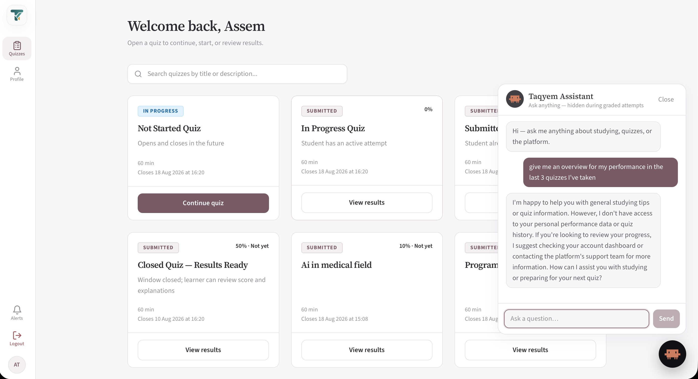

---

## Stack

| Layer | Choice |
| :--- | :--- |
| UI | React 19, Vite 8 |
| Styling | Tailwind CSS 4 (`@tailwindcss/vite`) |
| Data | RTK Query (normalized tags, cache invalidation) |
| Routing | React Router 7 |
| Auth session | JWT in `localStorage` + Bearer headers |
| Deploy | Static build; sample `nginx.conf` + `Dockerfile` |

---

## Technical maturity

The client is organized around **role-safe routes**, **cache-coherent API access**, and **attempt UX that tolerates flaky networks**—not a thin form shell.

### Data & session
- **RTK Query** as the single HTTP layer: tagged entities (`Quizzes`, `Attempt`, `AttemptReview`, `RecentSubmissions`, bank, follow-up, …) with targeted invalidation after mutations.
- **401 interceptor** clears session and returns the user to login without leaving stale caches behind.
- Login replaces the previous session and resets the API cache so role switches cannot leak data.

### Assessment UX
- Debounced answer persistence with in-flight coalescing and restore from server `attemptAnswers` (options + essay `textAnswer`).
- Server-authoritative remaining time; client countdown is visual only.
- Integrity: visibility-loss events posted while an attempt is in progress.
- Chat widget is suppressed on graded attempt surfaces to preserve exam integrity.

### Admin workflows
- Guided launch path: basics → questions → publish → invite, with clear primary/secondary actions.
- AI generation modal: topic / paste / PDF / image (OCR server-side), inline draft edit, selective save to bank or quiz.
- Attempt review supports human override of AI essay grades with score recomputation.
- Notification bell: per-submission feed (polled) plus follow-up summary; unread state persisted locally.

### Performance-conscious API use
- Polling intervals on alerts/follow-up are intentionally coarse (60–120s) to avoid chatty dashboards.
- List/detail tags keep navigation snappy without refetching the entire admin graph.

### Alignment with API indexes

The UI’s hottest reads match backend index design (see API README):

| Client workload | Server index support |
| :--- | :--- |
| Admin alerts / recent submissions | `Attempt (status, submittedAt)` |
| Learner quiz list | `Enrollment (studentId)`, `Attempt (studentId)` |
| Admin quiz catalog by status | `Quiz (status, createdAt)` |
| Per-quiz results & sweeps | `Attempt (quizId, status)` |
| Essay review queues | `Answer (gradingStatus)` |

---

## Prerequisites

- Node.js **20+**
- Running Taqyem API (see backend README), typically `http://localhost:3000`

---

## Quick start

```bash
npm install
cp .env.example .env     # set VITE_API_BASE_URL
npm run dev
```

App default: `http://localhost:5173`

### Demo accounts

Provisioned by **backend** seed (`npx prisma db seed`):

| Role | Email | Password | Entry |
| :--- | :--- | :--- | :--- |
| Learner | `assem.test@example.com` | `Student123!` | `/` |
| Admin | `admin@example.com` | `Admin123!` | `/admin/quizzes` |

Register additional learners at `/register` (verify via backend mail log / OTP in development).

---

## Environment

| Variable | Required | Purpose |
| :--- | :--- | :--- |
| `VITE_API_BASE_URL` | Yes (prod) | API origin |
| `VITE_MOCK_STUDENT_ID` | Dev only | Header fallback if unauthenticated |
| `VITE_ADMIN_TOKEN` | Dev only | Must match API `ADMIN_API_TOKEN` |

Production builds require `VITE_API_BASE_URL`. Dev mocks must never ship as the primary auth path.

**Secrets:** commit only `.env.example`. Share matching local tokens privately if the team wants identical header fallbacks—never in public PRs.

---

## Scripts

| Command | Purpose |
| :--- | :--- |
| `npm run dev` | Vite dev server |
| `npm run build` | Production bundle → `dist/` |
| `npm run preview` | Serve the production build locally |
| `npm run lint` | ESLint |

---

## Key routes

| Path | Audience |
| :--- | :--- |
| `/login`, `/register`, `/verify-email`, `/reset-password` | Auth |
| `/` | Learner dashboard |
| `/quizzes/:quizId` | Gateway / start |
| `/quizzes/:quizId/attempt` | Timed attempt (shell without chat) |
| `/invite/:token` | Invitation accept |
| `/admin/quizzes` | Admin catalog |
| `/admin/quizzes/launch` | Launch wizard |
| `/admin/quizzes/:quizId` | Workspace (overview, access, results, settings) |
| `/admin/quizzes/:quizId/questions` | Question bank for quiz |
| `/admin/question-bank` | Global bank |
| `/admin/attempts/:attemptId` | Attempt review |
| `/admin/follow-up` | Morning follow-up |

---

## Project layout

```
src/
  app/                 Router, store, shell
  features/
    auth/              Login, register, verify, reset
    adminQuizzes/      Catalog, workspace, launch, review
    adminFollowUp/     Follow-up dashboard
    questionBank/      Global + quiz questions, forms
    studentQuizzes/    Dashboard, attempt, results
    ai/                Chat widget, generate modal
  shared/              Shell, sidebar, notification bell, API base
  assets/              Brand images & icons (imported by the app)
public/                Deploy-only static files (e.g. SPA redirects)
```

---

## Build & deploy

```bash
npm run build
```

Serve `dist/` behind TLS (sample `nginx.conf` / `Dockerfile` included). Point `VITE_API_BASE_URL` at the API origin **at build time** (Vite inlines env).

Ensure API CORS allows the web origin (`FRONTEND_URL` / `CORS_ORIGINS` on the server).

---

## Documentation

| Doc | Purpose |
| :--- | :--- |
| [docs/PROJECT_OVERVIEW.md](docs/PROJECT_OVERVIEW.md) | Web-side handoff pointer |
| [CONTRIBUTING.md](CONTRIBUTING.md) | Branch & PR workflow |
| Backend docs | Architecture, AI generation, API Swagger (`/api`) |

---

## Related

- API service: sibling `backend/` repository (NestJS + Prisma + PostgreSQL).
- Backend handoff: `docs/PROJECT_OVERVIEW.md`, `docs/ARCHITECTURE.md`, `docs/AI_QUESTION_GENERATION.md`.
- Screenshots: `docs/screenshots/`.
